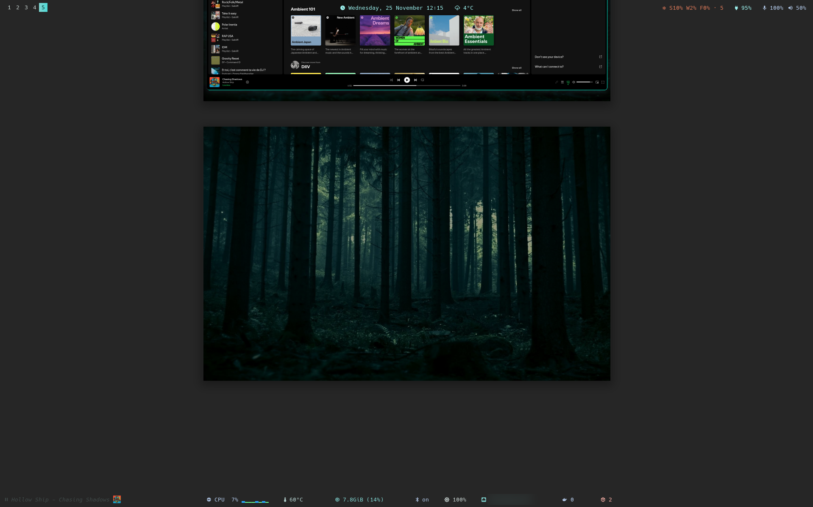

# dotfiles

My Wayland rice: **niri** (scrollable tiling) + **waybar** + **kitty** + **fuzzel** + **dunst**,
all in a dark teal "forest" palette taken from the wallpaper with matugen.



- **Compositor:** [niri](https://github.com/YaLTeR/niri), no X11 (Xwayland through `xwayland-satellite`)
- **Bars:** two waybar bars. Top: workspaces, clock, weather, Claude usage, battery, audio. Bottom: Spotify + cava, CPU, memory, Bluetooth, network, Docker, updates
- **Launcher / window switcher:** fuzzel
- **Notifications:** dunst, with a shared Pango-markup style (`scripts/notify-style.sh`)
- **Terminal / shell:** kitty + zsh (oh-my-zsh, catppuccin theme) + tmux
- **Font:** Hack Nerd Font (included in `fonts/`)
- **Palette:** every color and where it is used is in [`config/palette.txt`](config/palette.txt)

Tested on **Ubuntu 26.04 LTS**.

---

## Repository layout

| Path | Goes to | What |
|---|---|---|
| `niri/config.kdl`, `niri/glitch_01.kdl` | `~/.config/niri/` | compositor config, keybinds, startup programs |
| `waybar/` | `~/.config/waybar/` | `verbcol.jsonc` (bars), `modules.jsonc`, `mono.css`, `scripts/` |
| `fuzzel/fuzzel.ini` | `~/.config/fuzzel/` | launcher |
| `dunst/dunstrc` | `~/.config/dunst/` | notifications |
| `kitty/` | `~/.config/kitty/` | terminal + forest theme |
| `config/palette.txt` | `~/.config/palette.txt` | color reference |
| `zsh/.zshrc` | `~/.zshrc` | shell, aliases, helpers (`goclaude`, `burp`, `nmapFast`…) |
| `zsh/catppuccin.zsh-theme`, `zsh/catppuccin-flavors/` | `~/.oh-my-zsh/themes/` | prompt theme |
| `tmux/.tmux.conf` | `~/.tmux.conf` | tmux (plugins through tpm) |
| `vim/.vimrc` | `~/.vimrc` | vim (plugins through Vundle) |
| `git/.gitconfig` | `~/.gitconfig` | git; identity goes in `~/.gitconfig.local` |
| `scripts/*` | `~/.local/bin/` | scripts, see [Scripts](#scripts) |
| `scripts/notify-style.sh` | `~/.local/lib/` | shared notification style, sourced by the scripts |
| `icons/*.png` | `~/.local/share/icons/hicolor/128x128/apps/` | notification icons |
| `fonts/HackNerdFont/` | `~/.local/share/fonts/` | Hack Nerd Font (+ Propo) |
| `systemd/user/` | `~/.config/systemd/user/` | btop in a tmux session, served in the browser by ttyd |
| `cron/crontab` | `crontab` | battery, update and Claude usage checks |
| `vscode/config.json` | `~/.config/Code/User/settings.json` | VSCode settings |
| `vscode/python.json` | `~/.config/Code/User/snippets/python.json` | VSCode snippets |
| `burp/burp_conf.json` | Burp → *Settings → Import* | Burp Suite user options |

### Scripts

| Script | Installed as | What it does |
|---|---|---|
| `startup.sh` | `startup.sh` | starts the daily apps and moves each one to its niri workspace (`--delay 1m`) |
| `lock.sh` | `lock` | swaylock on a blurred wallpaper, with the wttr.in weather on top |
| `screenshot.sh` | `screenshot` | region capture with grim + slurp: `--clip`, `--clip-image`, `--notify` |
| `niri-window-switcher` | `niri-window-switcher` | pick any open window in fuzzel |
| `battery-check.sh` | `battery-check` | notification when the battery changes band (cron) |
| `check-update` | `check-update` | pending apt updates: notification (cron) or waybar JSON (`--waybar`) |
| `updates.sh` | `updates.sh` | apt + snap + firmware upgrade, Discord update (waybar click) |
| `claude-credit-check` | `claude-credit-check` | Claude Code usage notification (cron) |
| `claude-grep` | `claude-grep` | search Claude Code sessions in fzf and resume the one you pick |
| `wifi.sh` | `wifi.sh` | opens `nmtui` in kitty (waybar click) |
| `dotenv` | `dotenv` | python-dotenv CLI entry point |

---

## Dependencies

### 1. System packages

**Arch** (official repos + AUR through [yay](https://github.com/Jguer/yay)). On Arch most of
sections 2 and 3 are packaged too, so this one line covers almost everything:

```sh
yay -Syu --needed \
  zsh tmux gvim git github-cli curl jq w3m imagemagick \
  bat hexyl cmatrix radare2 nmap ffuf eza fzf broot tokei \
  niri xwayland-satellite waybar fuzzel dunst libnotify swaybg swaylock grim slurp wl-clipboard \
  lxsession-gtk3 thunar xdg-utils gnome-keyring \
  xdg-desktop-portal xdg-desktop-portal-gnome xdg-desktop-portal-gtk \
  wireplumber libpulse pavucontrol playerctl brightnessctl \
  bluez bluez-utils blueman networkmanager fwupd glib2 \
  btop cava ttyd kitty uv httpie python-dotenv docker \
  keepassxc signal-desktop discord \
  wttrbar matugen-bin spotify visual-studio-code-bin firefox-esr-bin
```

> Use `-Syu`, not `-Sy` alone: a sync without the upgrade is a partial upgrade, which Arch
> does not support. Without yay, drop the last line (AUR) and run the rest with `sudo pacman -Syu --needed`.
> Still needed by hand: oh-my-zsh, zplug, tpm, Vundle, Claude Code (see section 3).

**Ubuntu / Debian:**

```sh
sudo apt install \
  zsh tmux vim-gtk3 git gh curl jq w3m imagemagick \
  bat hexyl cmatrix radare2 nmap ffuf \
  waybar fuzzel dunst libnotify-bin swaybg swaylock grim slurp wl-clipboard \
  lxpolkit thunar xdg-utils gnome-keyring \
  xdg-desktop-portal xdg-desktop-portal-gnome xdg-desktop-portal-gtk \
  wireplumber pulseaudio-utils pavucontrol playerctl brightnessctl \
  bluez blueman network-manager fwupd libglib2.0-bin \
  btop cava ttyd \
  pipx keepassxc
```

| Package | Used by |
|---|---|
| `waybar` `fuzzel` `dunst` `swaybg` `lxpolkit` | niri startup + keybinds |
| `swaylock` `imagemagick` `curl` | `lock` |
| `grim` `slurp` `wl-clipboard` | `screenshot`, vim clipboard (`wl-copy` / `wl-paste`), `clip` alias |
| `libnotify-bin` (`notify-send`), `dunst` (`dunstify`) | every notification |
| `wireplumber` (`wpctl`), `pulseaudio-utils` (`pactl`), `pavucontrol` | volume keys, waybar audio group |
| `playerctl` | media keys |
| `brightnessctl` | brightness keys |
| `bluez` (`bluetoothctl`), `blueman` | waybar bluetooth module |
| `network-manager` (`nmtui`) | `wifi.sh` |
| `libglib2.0-bin` (`gdbus`) | waybar Spotify cover |
| `fwupd` | `updates.sh` |
| `jq` | waybar scripts, `check-update`, `niri-window-switcher`, `startup.sh`, `claude-grep` |
| `btop` `ttyd` `tmux` | waybar CPU click, `systemd/user/*btop*` |
| `cava` | waybar visualizer |
| `xdg-desktop-portal-*` `gnome-keyring` | screen sharing, file pickers, secrets under niri |
| `bat` `hexyl` `cmatrix` `radare2` (`rax2`) `w3m` | zsh aliases `cat`, `x`, `m`, `random`, `render` |
| `nmap` `ffuf` | zsh helpers `nmapFast*`, `fuzz` |

### 2. Rust / cargo

Install Rust with [rustup](https://rustup.rs), then:

```sh
cargo install --locked xwayland-satellite wttrbar broot tokei matugen
```

- **niri:** build it from source, see the [niri build guide](https://github.com/YaLTeR/niri/wiki/Getting-Started).
  `niri-session` and the `niri.service` / `niri-shutdown.target` units come from the niri repository.
- `xwayland-satellite`: X11 apps under niri
- `wttrbar`: waybar weather
- `broot`: `br` (sourced in `.zshrc`)
- `tokei`: `cloc` alias
- `matugen`: regenerates the palette from a wallpaper (optional)

### 3. Other installers

| Tool | Install | Used by |
|---|---|---|
| kitty | `curl -L https://sw.kovidgoyal.net/kitty/installer.sh \| sh /dev/stdin`, then `ln -s ~/.local/kitty.app/bin/kitty ~/.local/bin/` | terminal, `startup.sh`, waybar clicks |
| eza | [GitHub release](https://github.com/eza-community/eza/releases) binary in `~/.local/bin` | `ls` / `l` aliases |
| fzf | `git clone --depth 1 https://github.com/junegunn/fzf ~/.fzf && ~/.fzf/install` | `.zshrc`, `claude-grep` |
| oh-my-zsh | [ohmyz.sh](https://ohmyz.sh) | `.zshrc` |
| zplug | `git clone https://github.com/zplug/zplug ~/.zplug` | `.zshrc` (git, docker, syntax highlighting, fzf-tab) |
| tpm | `git clone https://github.com/tmux-plugins/tpm ~/.tmux/plugins/tpm`, then `prefix + I` in tmux | `.tmux.conf` |
| Vundle | `git clone https://github.com/VundleVim/Vundle.vim ~/.vim/bundle/Vundle.vim`, then `:PluginInstall` | `.vimrc` |
| uv | `curl -LsSf https://astral.sh/uv/install.sh \| sh` | Python tooling |
| httpie | `pipx install httpie` | `http`, `https`, `httpburp` aliases |
| python-dotenv | `pipx install "python-dotenv[cli]"` | `dotenv` |
| Docker | [docs.docker.com](https://docs.docker.com/engine/install/ubuntu/) | waybar Docker module, `dc` alias |
| Claude Code | `curl -fsSL https://claude.ai/install.sh \| bash` | waybar Claude module, `claude-credit-check`, `claude-grep`, `goclaude` |

### 4. Apps opened by `startup.sh`

Firefox ESR (`apt` from the [Mozilla repo](https://support.mozilla.org/kb/install-firefox-linux)), VSCode (`code`, [deb](https://code.visualstudio.com)), KeePassXC (`apt`),
Discord ([deb](https://discord.com/download), then `updates.sh`), Signal (`apt` from the
[Signal repo](https://signal.org/download/linux/)), Spotify (`snap install spotify`).
Edit the tables at the top of `scripts/startup.sh` to change the apps or their workspaces.

---

## Install

The files are plain copies, not symlinks. From the repository root:

```sh
# configs
mkdir -p ~/.config/{niri,waybar,fuzzel,dunst,kitty,systemd/user} ~/.local/{bin,lib} \
         ~/.local/share/icons/hicolor/128x128/apps ~/.local/share/fonts ~/Pictures/Screenshots
cp niri/*.kdl            ~/.config/niri/
cp -r waybar/*           ~/.config/waybar/
cp fuzzel/fuzzel.ini     ~/.config/fuzzel/
cp dunst/dunstrc         ~/.config/dunst/
cp kitty/*.conf          ~/.config/kitty/
cp config/palette.txt    ~/.config/
cp zsh/.zshrc tmux/.tmux.conf vim/.vimrc git/.gitconfig ~/
cp -r zsh/catppuccin.zsh-theme zsh/catppuccin-flavors ~/.oh-my-zsh/themes/

# scripts (some lose their extension when installed)
cp scripts/notify-style.sh ~/.local/lib/
for f in check-update claude-credit-check claude-grep dotenv niri-window-switcher startup.sh updates.sh wifi.sh; do
  install -m 755 "scripts/$f" ~/.local/bin/
done
install -m 755 scripts/battery-check.sh ~/.local/bin/battery-check
install -m 755 scripts/lock.sh          ~/.local/bin/lock
install -m 755 scripts/screenshot.sh    ~/.local/bin/screenshot

# icons, fonts
cp icons/*.png ~/.local/share/icons/hicolor/128x128/apps/
cp -r fonts/HackNerdFont ~/.local/share/fonts/ && fc-cache -f

# git identity (kept out of the repo)
printf '[user]\n\tname = Your Name\n\temail = you@example.com\n' > ~/.gitconfig.local

# btop in the browser on http://127.0.0.1:7682
cp systemd/user/*.service ~/.config/systemd/user/
systemctl --user daemon-reload && systemctl --user enable --now btop-session ttyd-btop

# cron (replaces the current crontab)
crontab cron/crontab
```

Then:

- Put a wallpaper at `~/Pictures/forest.png` (used by `swaybg` in niri and by `lock`).
- Log in to a **niri** session from the display manager.
- In tmux, press `prefix + I` to install the plugins. In vim, run `:PluginInstall`.
